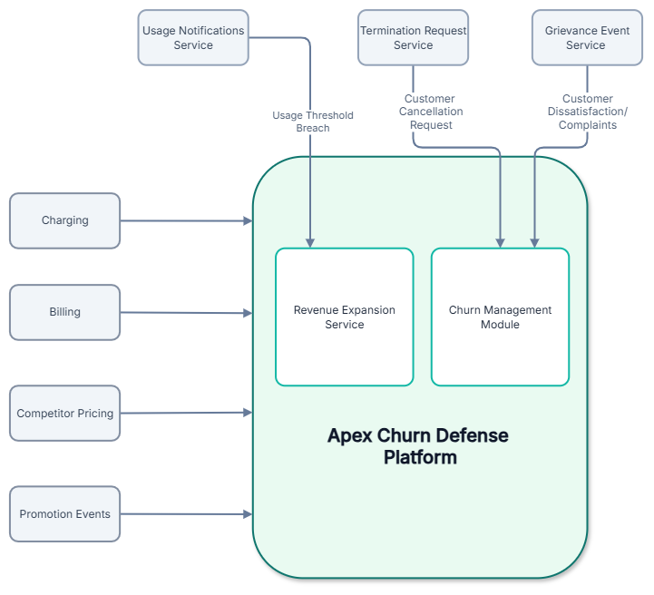
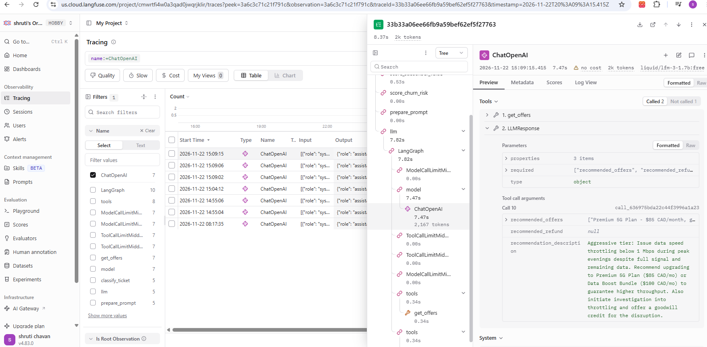

# Apex Churn Defense System

> **Telecom carriers lose over $65 billion annually to subscriber churn.** Most retention happens too late — after the customer has already decided to leave. What if an AI agent could intercept the earliest signals of dissatisfaction and act before that decision is made?

Apex is an **LLM-powered retention agent** that intercepts churn signals in real time — bill grievances, overage complaints, billing disputes, and cancellation requests — and autonomously enriches each case by pulling context from billing, charging, usage, competitor pricing, and catalog systems through **tool calling**.

The agent reasons over the assembled evidence to recommend retention actions — targeted offers, refunds, or one-time credits — **ranked by churn risk and subscriber lifetime value**. Every recommendation ships with a full audit trail of the signals ingested and tools invoked, making each decision traceable and reproducible.

**Monetary actions are advisory-only.** Refunds and credits require explicit human approval before execution, enforcing a human-in-the-loop boundary between AI reasoning and financial impact.

---

## Architecture

<p align="center">
  
</p>

The platform receives churn signals from three event sources — **usage threshold breaches**, **cancellation requests**, and **customer grievances** — and enriches them from charging, billing, competitor pricing, and promotion systems to build a complete subscriber context before the retention agent acts.

---

## Engineering Highlights

### 🔒 Human-in-the-Loop for Monetary Actions
The agent can *recommend* a $50 credit or a plan upgrade — but it cannot execute it. Every monetary action is gated behind a human approval step, keeping the system advisory-only. This isn't just a flag; the approval boundary is enforced architecturally so the agent literally cannot bypass it.

### 📐 Typed Contracts at Every Boundary
Pydantic models enforce strict typing at every integration point — inbound API requests, upstream system responses, LLM tool inputs/outputs, and recommendation payloads. If a shape is wrong, it fails fast and loud. This makes the entire tool-calling chain reproducible: given the same inputs, the agent produces the same evidence and recommendation.

### 🔌 TM Forum Open API Compliance
The system speaks the telecom industry's standard language. Churn signals arrive as TMF621 Trouble Tickets. Enrichment pulls from TMF676 (payments), TMF677 (consumption/balances), and TMF635 (usage history). This isn't a toy wrapper — the models are built from the actual OAS/Swagger specs, with only required fields implemented to keep the surface minimal.

### 🧪 Stub-First Development
Every upstream integration has a local stub server that returns realistic data. Tests run entirely in-process against these stubs — no Docker, no external services, no network calls. This means the full test suite runs in under a second and the system is demonstrable without any infrastructure.

### 📋 Audit-Ready Recommendations
Each recommendation carries the complete chain: which signals triggered it, which tools were called, what data was returned, and how the agent weighted the evidence. This isn't just logging — it's a first-class data structure designed for compliance review.

---

## Quick Start

```bash
# Install dependencies
uv sync

# Run the server and stub one by one 
uv run uvicorn src.main:app --reload --port 8080

#Or run all servers and stubs on bash at once
(trap 'kill 0' SIGINT; \
uv run uvicorn stubs.billing:app --port 9001 & \
uv run uvicorn stubs.charging:app --port 9002 & \
uv run uvicorn stubs.usage_history:app --port 9003 & \
uv run uvicorn stubs.catalog:app --port 9005 & \
uv run uvicorn apex_churn_defense.main:app --reload --port 8080)

# Run tests
uv run pytest -q
```

> Requires **Python 3.11+** and **[uv](https://docs.astral.sh/uv/)**. Tests run against in-process stubs — no external services needed.

---

## Tech Stack

| | |
|---|---|
| **Language** | Python 3.11 |
| **Framework** | FastAPI |
| **Agent Orchestration** | LangGraph — stateful workflow graph with SQLite checkpointing |
| **LLM** | LangChain + OpenAI SDK via OpenRouter — tool-calling agent with structured outputs |
| **Observability** | Langfuse — end-to-end tracing of every workflow run |
| **Validation** | Pydantic v2 — strict types at every boundary |
| **HTTP** | httpx (async) |
| **Logging** | structlog |
| **Testing** | pytest with in-process stub servers |
| **Standards** | TM Forum Open APIs (TMF620, TMF621, TMF635, TMF676, TMF677) |

---

## Status

The risk engine builds a subscriber profile and computes churn risk, subscriber value, and an action tier from the enriched signals. 
TMF621 grievance intake, TMF676 payment, TMF677 consumption, TMF635 usage history, and TMF620 catalog reads are implemented against local stubs and covered by tests.
A LangGraph-orchestrated LLM retention agent then classifies the ticket, consumes the risk profile as tool inputs, fetches sellable offers, and can propose a refund — with every run traced in Langfuse. 
Recommendations remain advisory: refund and one-time credit execution (TMF654) and competitor pricing enrichment are next, gated behind human approval.

---

## Observability & Run Logs

Each workflow run is traced end to end in Langfuse, from ticket classification and risk scoring through every tool call and the final structured recommendation.

<p align="center">
  <a href="docs/langfuse_tracing.png">
    
  </a>
</p>

Full server and workflow logs live in [`run_logs/`](run_logs/). A sample from `log_11_22_2026.log`:

```text
2026-11-22 15:09:14 [info     ] Running Churn Defence Workflow for ticket: e1f0f523-6952-4f51-904d-11a80508ff7c
2026-11-22 15:09:14 [info     ] Classifying ticket: e1f0f523-6952-4f51-904d-11a80508ff7c
INFO:     127.0.0.1:64312 - "POST /tmf-api/usageConsumption/v5/queryUsageConsumption HTTP/1.1" 201 Created
INFO:     127.0.0.1:64311 - "GET /payment/v4/payment?offset=0&limit=100 HTTP/1.1" 200 OK
INFO:     127.0.0.1:64313 - "GET /tmf-api/productUsageManagement/v5/productUsage?offset=0&limit=100 HTTP/1.1" 200 OK
2026-11-22 15:09:15 [info     ] subscriber risk profile        risk_profile=SubscriberRiskProfile(party_id='sub-456', evaluated_at=datetime.datetime(2026, 11, 22, 20, 9, 14, 873517, tzinfo=datetime.timezone.utc), failed_payments_90d=1, tenure_months=26, total_revenue=Money(unit='CAD', value=1125.44), avg_monthly_revenue=Money(unit='CAD', value=43.29), usage_trend_pct=-0.31428571428571433, bucket_remaining_pct=0.04, usage_events_30d=1, usage_events_prev_30d=3, usage_event_trend_pct=-0.6666666666666666, failed_usage_events=1, grievance_count_90d=1, grievance_max_severity='major', sources={'tmf676_payment': 'ok', 'tmf677_usage': 'ok', 'tmf635_product_usage': 'ok', 'tmf621_trouble_ticket': 'ok'}, data_gaps=[])
2026-11-22 15:09:15 [info     ] subscriber risk score          risk_score=RiskScore(churn_risk=10, subscriber_value=6, priority=60, action_tier='aggressive', confidence='high', rubric_breakdown={'churn.failed_payment': 3, 'churn.grievance_severity': 2, 'churn.usage_trend': 2, 'churn.bucket_balance': 1, 'churn.usage_event_trend': 1, 'churn.failed_usage_event': 1, 'value.tenure': 3, 'value.avg_monthly_revenue': 2})
INFO:     127.0.0.1:64323 - "GET /tmf-api/productCatalogManagement/v5/productOffering?offset=0&limit=100 HTTP/1.1" 200 OK
INFO:     127.0.0.1:64324 - "GET /tmf-api/productCatalogManagement/v5/productOffering?offset=0&limit=100 HTTP/1.1" 200 OK
2026-11-22 15:09:23 [info     ] LLM recommendations            recommendation=LLMResponse(recommended_offers=['Premium 5G Plan - $85 CAD/month, guaranteed 3 Mbps download at peak times', 'Data Boost Bundle - $100 CAD/month, includes 10GB extra data and priority scheduling'], recommended_refund=None, recommendation_description='Aggressive tier: Issue data speed throttling below 1 Mbps during peak evenings despite full signal and remaining data. Recommend upgrading to Premium 5G Plan ($85 CAD/mo) or Data Boost Bundle ($100 CAD/mo) to guarantee higher throughput. Also initiate investigation into throttling and offer a goodwill credit for the disruption.')
INFO:     127.0.0.1:64309 - "POST /tmf-api/troubleTicket/v5/troubleTicket HTTP/1.1" 201 Created
```

---

## License

This project is shared for portfolio and discussion purposes.  
All rights reserved — not licensed for reuse or redistribution.
